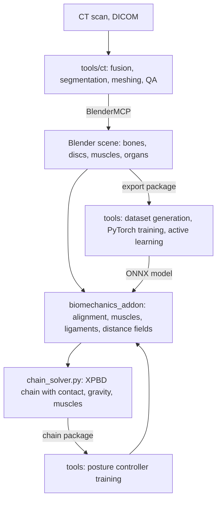

# Blender Biomechanics

A Blender add-on (Python) that simulates the human spine, with a medical-imaging pipeline that turns a CT scan
(DICOM) into per-structure 3D meshes, and PyTorch models exported to ONNX that run inside Blender.

## At a glance

- **Problem:** explore how the bones of a real person's spine and pelvis can move against each other. That needs
  accurate per-bone meshes from a scan, a solver fast enough to drag bones interactively, and a quick answer to
  "is this pose geometrically possible?".
- **Add-on** ([biomechanics_addon/](biomechanics_addon/), about 10,400 lines of Python): alignment of two copies of
  a skeleton, muscle strings and sheets, ligaments and discs, signed distance fields for contact, and an interactive
  chain solver (XPBD) with gravity and active muscles.
- **CT pipeline** ([tools/ct/](tools/ct/), about 6,500 lines): DICOM series to meshes with TotalSegmentator and
  nnInteractive, Fourier-domain fusion of three series into isotropic volumes, atlas registration (ICP) and
  overlap QA. Recorded result: 166 meshes from one scan.
- **Neural models** ([tools/](tools/)): a pose-feasibility network trained on synthetic labels made in background
  Blender, with active learning and ONNX export, and a muscle posture controller trained with an evolution strategy.
- **Chain solver, recorded:** whole trunk on the femurs, 22 bodies, 540 constraints, 449 muscle strings, about
  120 ms per solve.
- **Distance fields, recorded on L5:** 99.8% sign agreement with ray parity, 0.46 mm maximum distance error.
- **Tests:** 89 unit tests for the bpy-free modules, all passing (checked Nov 12, 2026, Python 3.13). No CI.

The CT, solver and distance-field numbers are recorded in this repository's own docs. The scan is not in the
repository, so they cannot be re-measured from it.

**Stack:** Python, NumPy, Blender Python API (bpy), PyTorch, ONNX, ONNX Runtime, active learning, synthetic data
generation, evolution strategies, neural surrogate models, medical imaging, CT, DICOM, 3D segmentation
(TotalSegmentator, nnInteractive), SimpleITK, SciPy, scikit-image, nibabel, pydicom, trimesh, ICP registration,
signed distance fields, XPBD physics solver, glTF / Draco export, Model Context Protocol (BlenderMCP, 3D Slicer MCP),
PowerShell, unit tests.

## My role

This is my own project (Hen Cohen). I chose the problem, the methods and the experiments, and I ran and checked the
results on my own scan data. Much of the code was written with AI coding agents under my direction.
[AGENTS.md](AGENTS.md) holds the standing rules for the agents, and [DEVELOPMENT_PLAN.md](DEVELOPMENT_PLAN.md) is
the handoff document between sessions. My part is the engineering judgment: deciding what to measure, comparing
methods on a fixed yardstick, and recording what did not work.

## Architecture



- **Add-on:** runs inside Blender. The solver and distance fields are pure NumPy and are tested without Blender.
- **CT pipeline:** runs outside Blender and sends meshes to the open scene over the BlenderMCP socket.
- **Training tools:** generate labels in background Blender, train in PyTorch, and publish an ONNX model only after
  PyTorch and ONNX Runtime agree.

The full diagram and a key-files table are in [docs/REFERENCE.md](docs/REFERENCE.md).

## Quick start

1. Install Blender 3.6 or newer.
2. Open this folder in VS Code, press `Ctrl+Shift+B` and pick **Blender: Run Add-on from Source**.
3. In Blender's 3D Viewport, press `N` and open the **Biomechanics** tab.

Other entry points:

```sh
.\tools\run_neural_training.ps1 -PackagePath ".\biomechanics_training"   # neural training, resumable
python tools/train_posture.py --package <dir> --mode policy              # posture controller
python tools/ct/run_ct.py --run "$RUN" --blender                         # CT pipeline
```

The CT pipeline needs your own CT scan and the segmentation model weights. No scan data is in this repository.
ZIP install, macOS notes and all parameters are in [docs/REFERENCE.md](docs/REFERENCE.md).

## Tests

```sh
python -m unittest discover -s tests        # 89 tests, under a second, no Blender needed
```

Blender runtime and UI changes are checked by hand with the checklist in
[DEVELOPMENT_PLAN.md](DEVELOPMENT_PLAN.md).

## Status

Active research project, started Aug 2026. The last change is from Nov 4, 2026. It is not a medical device and
makes no clinical claims.

- **Working:** alignment and comparison, muscle strings and sheets, ligaments and discs, collision fields, the chain
  solver with pelvic joints, the pose-feasibility pipeline with ONNX inference in Blender, and the CT pipeline for
  bones, discs, muscles, organs and heart.
- **Not working yet:** a posture controller that holds the spine up. The best policy so far still sags (score -8.5
  passive to -4.83), and the surrogate training route did not beat it (best -6.6).
- **Open:** the neural pipeline's last validation phase, re-running the disc parameter tool on the new bone masks,
  and saving label grids for the fused run.
- **Next:** split hands and feet into bones, retrain posture after rebuilding strings, make atlas registration an
  operator, add the cervical chain.
- **Licences:** some third-party model weights and atlases are non-commercial or share-alike. See the reference.

## More docs

- [docs/REFERENCE.md](docs/REFERENCE.md): recorded results, key files, setup, every tool and its parameters, the CT
  method and measurements.
- [DEVELOPMENT_PLAN.md](DEVELOPMENT_PLAN.md): current behavior, UI controls, validation checklist, next steps.
- [AGENTS.md](AGENTS.md): rules for AI coding agents working in this repository.
- [MUSCLE_ATTACHMENTS.md](MUSCLE_ATTACHMENTS.md) and [BONE_NEAREST_NEIGHBORS.md](BONE_NEAREST_NEIGHBORS.md):
  anatomy reference data.

## License

Free for noncommercial use under the [PolyForm Noncommercial License 1.0.0](LICENSE.md). For commercial use, ask for a
separate license. Third-party code, models and data keep their own licenses.
